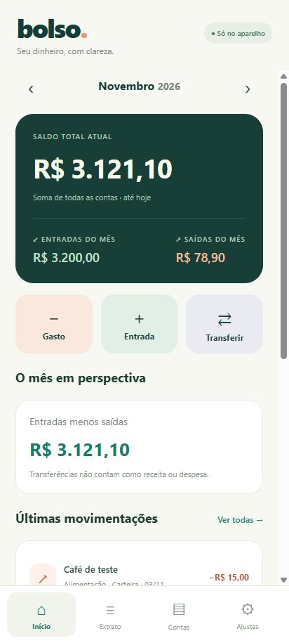
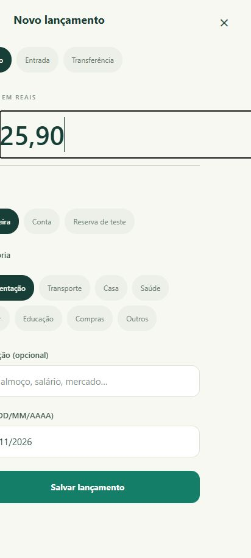
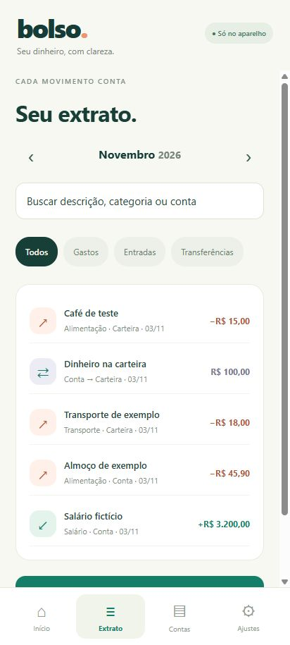

# Bolso · seu dinheiro, com clareza

Aplicativo pessoal de controle financeiro para Android: registre receitas e gastos rapidamente, acompanhe o mês e transfira valores entre contas. **Offline, sem cadastro, sem servidor e sem chave de API.**

Projeto open source de [Bernardo Reges](https://github.com/BernardoReges), desenvolvido com auxílio de IA. Licença MIT: você pode estudar, modificar e redistribuir o código conforme a licença.

## Telas

<p>
  
  
  
</p>

Capturas da prévia web em tamanho de celular, com dados fictícios usados nos testes. O aplicativo instalado começa vazio.

## O que já faz

- Registro rápido de gasto, entrada ou transferência, em reais.
- Categorias, descrição opcional e data do lançamento.
- Saldo total atual, receitas e despesas do mês e gastos por categoria.
- Extrato por mês, busca e filtros por tipo de movimentação.
- Edição e exclusão de lançamentos, com confirmação para excluir.
- Contas manuais com saldo inicial; saldos negativos são permitidos.
- Backup JSON, com validação e confirmação antes de substituir os dados.

Transferências alteram as contas de origem e destino, sem criar receitas ou despesas. O saldo total inclui todo o histórico e os saldos iniciais; os números do mês incluem somente receitas e gastos daquele mês. Os lançamentos representam movimentos realizados: datas futuras não são aceitas.

## Seus dados ficam com você

No Android, os dados são persistidos com SQLite dentro do armazenamento privado do aplicativo. Isso não exige servidor, assinatura nem conta em serviço de banco de dados. Não há integração com bancos, anúncios, analytics próprios ou sincronização remota. Atualizações remotas do Expo estão desativadas.

O armazenamento não usa criptografia adicional do aplicativo nem PIN próprio. Use o bloqueio do aparelho. O backup exportado contém valores e descrições em texto legível: você escolhe onde guardá-lo ou compartilhá-lo. Desinstalar ou limpar os dados pode apagar os registros. Faça backup antes de trocar de aparelho.

A versão web serve para desenvolvimento e usa o armazenamento do navegador, separado do SQLite do Android. Limpar os dados do navegador também apaga essa cópia.

## Como começar

1. Abra o aplicativo e registre uma entrada, ou crie uma conta com seu saldo inicial.
2. Toque em **Gasto** para lançar uma despesa. Valor e conta são obrigatórios; a descrição é opcional.
3. Use **Transferir** quando o dinheiro apenas mudar entre suas contas.
4. Abra **Extrato** para pesquisar ou toque em um lançamento para editar.
5. Em **Ajustes**, exporte um backup regularmente.

O aplicativo começa vazio. Os exemplos só são carregados quando você escolhe **Carregar demonstração** e confirma a substituição. Não use o exemplo sobre dados reais sem antes exportar um backup.

## Executar o projeto

Requisitos: Node.js 24 e npm. Para desenvolvimento Android local, também são necessários JDK e Android SDK; a visualização web não exige essas ferramentas.

```bash
npm ci
npm test
npm run web
```

Para desenvolver no celular, use `npm start` e um cliente Expo Go compatível com o SDK do projeto, ou um development build. O APK de release funciona sem Metro, computador ou conexão de rede.

## Gerar APK

### Compilação local com assinatura própria

Tenha Java e Android SDK instalados e configurados. Gere o projeto Android e defina uma pasta **privada fora do repositório** para guardar a assinatura:

```bash
npx expo prebuild --platform android --no-install
export BOLSO_SIGNING_DIR=/caminho/privado/assinatura-bolso
node scripts/configure-signing.cjs --build
```

No PowerShell, use `$env:BOLSO_SIGNING_DIR='C:\pasta-privada\assinatura-bolso'`. A pasta deve estar fora do clone. O script gera a chave privada na primeira execução, reutiliza-a nas próximas e compila para `arm64-v8a`. O arquivo fica em `android/app/build/outputs/apk/release/app-release.apk`.

Guarde uma cópia privada de **toda a pasta de assinatura**. Sem a mesma chave, não será possível instalar uma atualização sobre a versão anterior. Nunca publique essa pasta, `config.json`, `.jks`, `.keystore` ou credenciais. Os diretórios nativos são regenerados pelo Expo e ficam fora do Git.

### Alternativa com Expo EAS

O arquivo `eas.json` oferece o perfil `preview` para APK. Essa alternativa exige conta e configuração no Expo; as cotas e filas gratuitas dependem do plano vigente. Ela não é necessária quando a compilação é feita localmente. Consulte a [documentação oficial de APK](https://docs.expo.dev/build-reference/apk/).

```bash
npx eas-cli build --platform android --profile preview
```

## Testes e limites atuais

Oito testes automatizados verificam centavos inteiros, transferências, edição e exclusão, resumo mensal, validação de backup e datas inválidas, além da proteção dos arquivos de assinatura. O JavaScript Android foi exportado com sucesso. Na interface web, foram conferidos lançamento, edição, persistência após recarregar, cancelamento de exclusão e exportação/restauração de backup fictício.

A execução no aparelho físico ainda precisa ser conferida. Um bundle JavaScript exportado não comprova que todos os recursos nativos funcionam no celular. O workflow de CI roda testes e exporta o bundle Android; ele não compila um APK.

Esta primeira versão não possui cartão de crédito/fatura, parcelamentos, recorrências, múltiplas moedas, conciliação bancária, orçamento mensal ou sincronização. O backup substitui os dados em vez de mesclar. Limites de importação: 30 contas, 10 mil lançamentos e arquivo de até 5 MB. O saldo inicial cadastrado é zero ou positivo; saldos correntes podem ficar negativos pelos gastos.

## Estrutura

```text
App.jsx                    Interface React Native
src/ledger.cjs             Regras e validações financeiras
src/storage.native.js      Persistência SQLite no celular
src/storage.web.js         Persistência da prévia web
src/backup.native.js       Exportação e seleção de arquivos Android
src/backup.web.js          Backup na prévia web
tests/ledger.test.cjs       Testes sem dados pessoais
scripts/configure-signing.cjs  Assinatura privada e build local
```

## Contribuir

Abra uma issue com dados fictícios para descrever um problema ou proposta. Antes de enviar uma alteração, rode `npm test` e `npm run export:android`. Não anexe extratos, backups reais, credenciais ou chaves de assinatura. Mudanças no formato de dados devem manter compatibilidade com os backups ou oferecer uma migração explícita.
